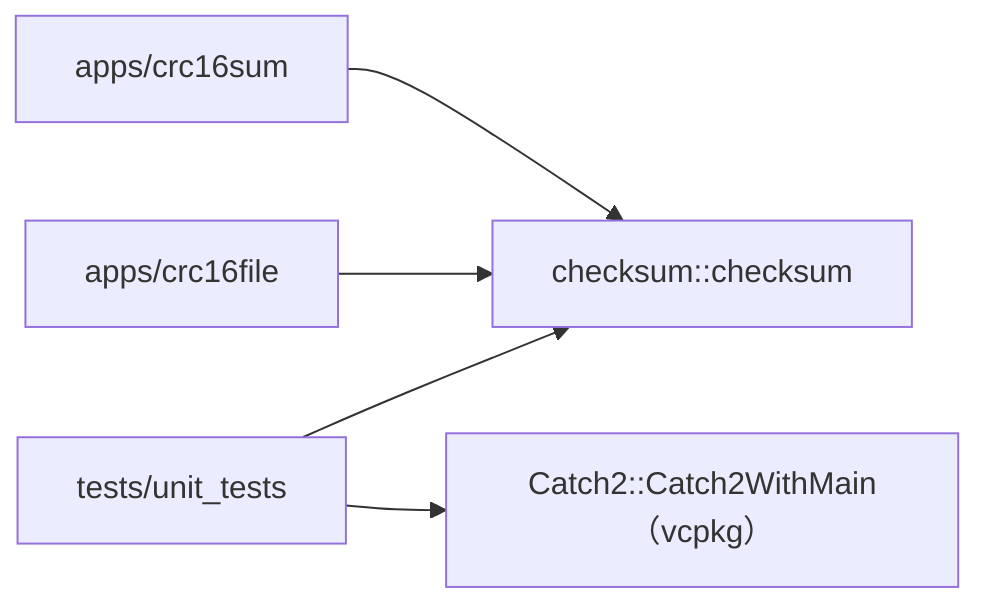

# 架构

<!-- 写给要理解、引导本项目的人的概览：代码地图、主要数据流、不变式与边界，以及每篇特性文档的链接。特性的细节写进 docs/<特性>.md。 -->

## 代码地图

<!-- target 依赖图，加每个模块一句话职责 -->

- `checksum`（示例）：CRC-16/CCITT-FALSE，C 接口在 `crc16.h`，C++ 封装在 `checksum.hpp`，演示 C/C++ 混合模块。
- `crc16sum`（示例）：打印各命令行参数的 CRC-16。
- `crc16file`（示例）：打印各文件内容的 CRC-16。
- `cmake/package.cmake`：每个 app 打成独立的 zip，见[构建系统](docs/build-system.md#打包)。

## 数据流

<!-- 主要的数据或请求如何在模块间流动，一条流程一张 Mermaid 图 -->

## 不变式与边界

<!-- 改动必须保持、代码本身看不出来的约束 -->

- 依赖方向：`apps`、`tests` → `src` → vcpkg 依赖；`src` 不依赖 `apps` 和 `tests`。

## 特性文档

- [构建系统](docs/build-system.md)：preset、三元组与链接方式、交叉编译
- [代码质量](docs/code-quality.md)：格式化器版本、各项检查在哪里运行
